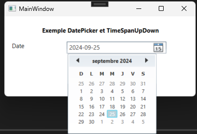

# Contrôle DatePicker en WPF

Le contrôle DatePicker dans WPF permet à l'utilisateur de sélectionner une date à partir d'un calendrier déroulant. Il est souvent utilisé pour faciliter la saisie des dates dans une interface graphique.

 

XAML
```xml
<Grid Margin="10">
    <StackPanel>
        <Label Content="Exemple DatePicker et TimeSpanUpDown" HorizontalAlignment="Center" FontWeight="Bold" Margin="5"/>
        <StackPanel Orientation="Horizontal">
            <TextBlock Text="Date" Width="100" Margin="5"/>
            <DatePicker Name="dpDate"  Width="200"  HorizontalAlignment="Left" Margin="5"/>
        </StackPanel>

        <Button x:Name="btnAfficher"  Content="Afficher" Width="100" Height="25" Click="btnAfficher_Click" Margin="5"/>

    </StackPanel>
  
</Grid>
```

Code
```c#

 private void Window_Loaded(object sender, RoutedEventArgs e)
 {
    dpDate.SelectedDate = DateTime.Now; //Sélectionne la date du jour
    
 }

 private void btnAfficher_Click(object sender, RoutedEventArgs e)
 {
 
    
     if(dpDate.SelectedDate != null)
     {
         DateTime date = (DateTime)dpDate.SelectedDate;
         MessageBox.Show($"date : {date.ToShortDateString()}");
     }
     else
     {
         MessageBox.Show("Aucun date n'est sélectionnée");
     }
        
 }

```


## Utiliser un DateOnly avec un DatePicker

Le contrôle `DatePicker` de WPF utilise une propriété de type `DateTime?` (`Nullable<DateTime>`). Il n'est donc pas possible de lui associer directement un objet `DateOnly`.

Il faut effectuer une conversion entre `DateOnly` et `DateTime`.

### Afficher un DateOnly dans un DatePicker

Supposons que l'on possède une propriété de type `DateOnly`.

```csharp
DateOnly dateNaissance = new(2000, 5, 15);
```

Pour l'afficher dans un `DatePicker`, il faut le convertir en `DateTime`.

```csharp
dpDateNaissance.SelectedDate =
    dateNaissance.ToDateTime(TimeOnly.MinValue);
```

Le contrôle affichera alors la date correspondante.

### Récupérer un DateOnly à partir d'un DatePicker

La propriété `SelectedDate` retourne un objet `DateTime?`.

```csharp
DateTime? dateSelectionnee = dpDateNaissance.SelectedDate;
```

Pour obtenir un objet `DateOnly`, il suffit d'utiliser la méthode `FromDateTime`.

```csharp
if (dateSelectionnee.HasValue)
{
    DateOnly dateNaissance =
        DateOnly.FromDateTime(dateSelectionnee.Value);

    Console.WriteLine(dateNaissance);
}
```

