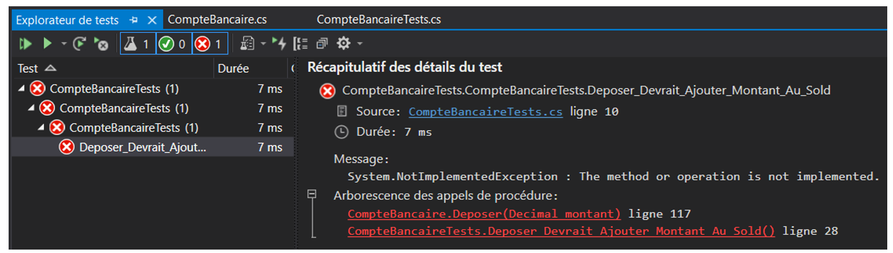
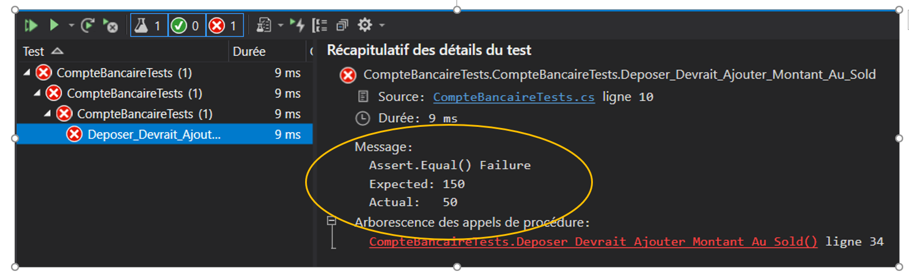
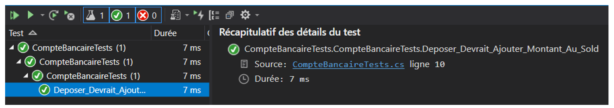
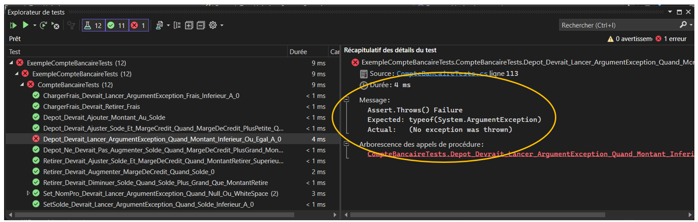
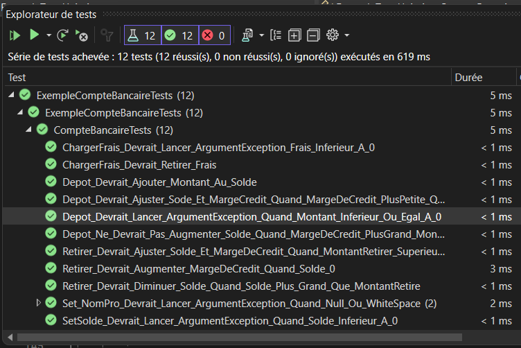
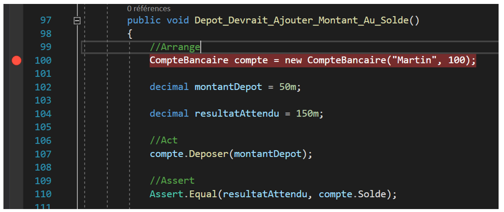
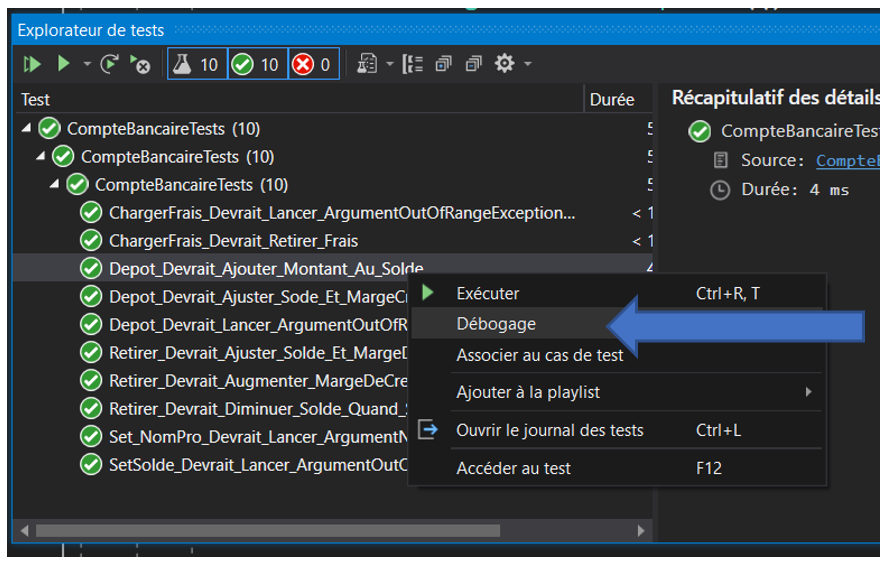

# Les tests unitaires en C#

Les tests unitaires offrent aux développeurs un moyen rapide de tester leur code afin de rechercher des erreurs de logique dans les méthodes de leurs classes. Il s'agit de **code** permettant de s'assurer que les méthodes des classes font exactement ce qu'elles sont censées faire même lorsque des correctifs sont apportés plus tard. Ceux-ci permettent donc de s'assurer de la qualité du code.

L'objectif principal d'un test unitaire est d'isoler une partie de code pour identifier, analyser et corriger les éventuelles erreurs de logique notamment pour les cas limites. C'est un moyen rapide et peu coûteux. Par exemple, il n'est pas nécessaire de développer une interface graphique pour tester une méthode qui crée un compte utilisateur. Il suffit d'écrire le test unitaire dédié.

Les tests unitaires sont écrits par le développeur responsable de la classe ou de la méthode. Ils lui permettent de s'assurer de livrer un code fonctionnel et testé. Ils sont en ce sens différents des tests fonctionnels ou des tests d'intégration qui interviennent plus tard dans le cycle de développement et qui permettent aux ingénieurs QA (Assurance qualité) de tester l'application dans son ensemble.

Ceux-ci ont l'avantage de :

- Réduire les erreurs dans les nouvelles fonctionnalités développées ou réduire les bogues lors de la modification du code dans des fonctionnalités existantes.
- Réduire les coûts de développement, car les erreurs sont détectées rapidement.
- Améliorer la conception et permettre une meilleure refactorisation du code.
- Servir de complément pour la documentation du code et comprendre le fonctionnement des méthodes.

Dans ce cours, vous n'aurez pas à écrire de tests unitaires (cette compétence est développée dans un autre cours). Vous devez cependant être en mesure d'**intégrer un projet de tests unitaires déjà existant** à votre solution, de **lire et d'exécuter ces tests**, de les **déboguer**, et de savoir **quoi faire lorsqu'une classe ou une méthode utilisée par les tests n'est pas encore codée**.

## Intégrer un projet de tests unitaires existant

Dans le cadre de vos travaux, un projet de tests unitaires vous sera fourni. Il s'agit d'un projet de type "**Projet de test xUnit C#**" contenant déjà les tests permettant de valider le comportement attendu des classes que vous devez coder.

Si ce projet n'est pas déjà présent dans votre solution, voici comment l'ajouter :

1. **Copiez le dossier** contenant le projet de tests fourni directement dans le dossier de votre solution (au même niveau que les dossiers des autres projets).
2. Dans l'**Explorateur de solutions**, faites un clic droit sur la solution et sélectionnez **Ajouter > Projet existant...**
3. Sélectionnez le fichier **.csproj** du projet de tests unitaires que vous venez de copier.
4. Assurez-vous que le projet de tests possède une **référence** vers le projet contenant les classes à tester (clic droit sur le projet de tests > **Ajouter** > **Référence de projet...**).

Par convention, chaque classe testée possède un fichier de tests correspondant portant le **nom de la classe suivi du suffixe "Tests"**. Par exemple, les tests de la classe **Client.cs** se trouvent dans le fichier **ClientTests.cs**.

### Composition d'un test

Prenons par exemple la classe **CompteBancaire.cs** suivante :

```c#
Public class CompteBancaire
{

    private const decimal LIMITE_MARGE_CREDIT = 5000;

    private String _nomProp;

    private decimal_solde;

    private decimal_margeCredit;


    public String NomProp
    {
        get { return _nomProp; }
        set { _nomProp = value; }
    }

    public decimal Solde
    {
        get { return _solde; }
        private set { _solde= value;}
    }


    public decimal MargeCredit
    {
        get { return _margeCredit; }
        private set { _margeCredit = value; }
    }


    public CompteBancaire(String nomProp, decimal solde = 0)
    {
        MargeCredit = 0;
        NomProp = nomProp;
        Solde = solde;
    }

    /// <summary>
    /// Permet de déposer un montant dans le compte.
    /// La marge de crédit est remboursée si elle n'est pas à zéro.
    /// </summary>
    /// <param name="montant">Montant à déposer (plus grand que zéro)</param>
    public void Deposer(decimal montant)
    {
        throw new NotImplementedException ();
    }

    /// <summary>
    /// Permet de retirer un montant dans le compte.
    /// La marge de crédit est utilisée si nécessaire et possible.
    /// </summary>
    /// <param name="montant">Montant à retirer (plus grand que zéro)</param>
    public void Retirer(decimal montant)
    {
        throw new NotImplementedException();
    }

    /// <summary>
    /// Permet de charger des frais de gestion de compte.
    /// </summary>
    /// <param name="frais">Montant des frais chargés</param>
    public void ChargerFrais(decimal frais)
    {
        throw new NotImplementedException();
    }


}

```

::: warning Remarque
Vous remarquerez que les méthodes de cette classe ne sont pas encore implémentées : seule leur signature a été créée, avec des commentaires spécifiant ce qu'elles devraient faire. C'est une situation que vous rencontrerez fréquemment : le projet de tests fourni contient déjà les tests, mais les méthodes qu'ils valident restent à coder.
:::

Le modèle **AAA** (Arrange, Act, Assert) est un moyen couramment utilisé pour structurer les tests unitaires d'une méthode testée. Comprendre ce modèle vous aidera à lire et interpréter les tests qui vous sont fournis.

- La section **Arrange** d’une méthode de test unitaire initialise les objets, définit la valeur des données passées en paramètre à la méthode testée ainsi que la valeur des résultats attendus.
- La section **Act** appelle la méthode testée avec les paramètres.
- La section **Assert** vérifie que l’action de la méthode testée se comporte comme prévu selon les résultats attendus.

Voici le test fourni pour valider la méthode "**Deposer**" lorsque la marge de crédit est à 0 :

```c#
public class CompteBancaireTests
{
    [Fact]
    public void Deposer_Devrait_Ajouter_Montant_Au_Sold_Quand_MageCredit_Egale_0()
    {

        //Arrange
        //Création d'un objet compte bancaire
        CompteBancaire compte = new CompteBancaire("Martin",100);

        //Montan à déposer
        decimal montantDepot = 50m;

        //Résultat attendu
        decimal resultatAttendu = 150m;

        //Act
        //Appel de la méthode pour le test

        compte.Deposer(montantDepot);

        //Assert
        //Vérification du solde du compte.
        Assert.Equal(montantDepot, compte.Solde);

    }
}
```

Pour exécuter les tests fournis, vous devez aller dans le menu "**Test**" de Visual Studio et sélectionner "**Exécuter tous les tests**". L'explorateur de test s'affichera et voici le résultat :



On voit ici que le test a échoué, car la méthode "**Deposer**" lance l'exception "**NotImplementedException**" pour indiquer que le code n'a pas été implémenté. Modifions le code de la méthode afin que le test fonctionne.

```c#
public void Deposer(decimal montant)
{
    this.Solde -= montant;
}
```

Exécutons à nouveau le test pour voir le résultat :



On voit que le test a échoué à nouveau et que le résultat actuel est 50 tandis que la valeur attendue est 150.
Corrigeons maintenant le code de la méthode :

```c#
public void Deposer(decimal montant)
{
    this.Solde += montant;
}

```

Exécutons à nouveau le test :



On voit ici que le test a réussi. Il n'y a donc pas d'erreur dans notre logique d'application.

Il est également possible de créer des tests qui s'assurent que des exceptions soient lancées par les méthodes. Par exemple, il ne devrait pas être possible de déposer un montant négatif. Dans ce cas-ci, la méthode "Deposer"devrait lancer une exception du type "**ArgumentOutOfRangeException**" spécifiant que le montant à déposer doit être supérieur à 0.

Voici le test correspondant à ce cas :

```c#
[Fact]
public void Deposer_Devrait_Lancer_ArgumentOutOfRangeException_Quand_Montant_Inferieur_A_0()
{
   //Arrange

   //Création d'un objet compte bancaire
   CompteBancaire compte = new CompteBancaire("Martin", 100);

   //Montant à déposer
   decimal montantDepot = -50m;

    //Act et Assert

    //Vérifie le lancement d'exception si montant <= 0
    Assert.Throws<ArgumentOutOfRangeException>(() => compte.Deposer(montantDepot));

}
```

Voici le résultat de l'exécution du test :



On voit ici que le test a échoué, car le code de la méthode ne lance pas d'exception. Voici la correction du code pour la réussite du test :

```c#
public void Deposer(decimal montant)
{
    if (montant <= 0)
        throw new ArgumentOutOfRangeException(nameof(montant), "Le montant doit être supérieur à 0.");

    this.Solde += montant;
}
```



## Que faire si une classe ou une méthode n'est pas encore codée?

Un projet de tests fourni fait référence aux classes, aux constructeurs, aux propriétés et aux méthodes de votre programme. Puisque vous recevez les tests avant d'avoir terminé votre code, deux situations peuvent se présenter.

### La méthode existe, mais son code n'est pas encore terminé

C'est le cas de l'exemple précédent avec la méthode **Deposer** : la signature de la méthode existe, mais son corps lance une exception **NotImplementedException** (ou contient un code incomplet). Dans ce cas :

- Le projet compile sans problème.
- Les tests associés à cette méthode **échouent** (affichés en rouge dans l'explorateur de tests).
- Il s'agit d'une situation normale : votre travail consiste à compléter le code de la méthode jusqu'à ce que les tests réussissent.

### La classe, la propriété ou la méthode n'existe pas du tout

Si vous n'avez pas encore créé une classe, une propriété ou une méthode utilisée par les tests, le **projet de tests ne compilera pas du tout**. Vous obtiendrez des erreurs de compilation semblables à celles-ci :

- `Le nom 'Client' n'existe pas dans le contexte actuel`
- `'Client' ne contient pas de définition pour 'Telephone'`

Dans ce cas, vous devez d'abord créer la classe, la propriété ou la méthode manquante avec la **signature exacte** attendue par les tests (même nom, mêmes types de paramètres et de retour), afin que la solution compile. Le corps de la méthode peut, pour commencer, simplement lancer une **NotImplementedException** : vous vous retrouverez alors dans la première situation décrite ci-dessus, et il ne vous restera qu'à compléter le code petit à petit en réexécutant les tests régulièrement.

Par exemple, pour que le fichier **ClientTests.cs** fourni compile et que ses tests puissent s'exécuter, la classe **Client** doit minimalement posséder :

- Un constructeur `Client(Guid id, string nom, string prenom, string telephone, string courriel, string adresse)`.
- Les propriétés `Id`, `Nom`, `Prenom`, `Telephone`, `Courriel` et `Adresse`.
- Une redéfinition de la méthode `ToString()`.

```c#
[Fact]
public void Constructeur_Devrait_Initialiser_Proprietes_Valides()
{
    Guid id = Guid.NewGuid();
    string nom = "Vézina";
    string prenom = "Martin";
    string tel = "418-123-4567";
    string courriel = "martin@cegepgarneau.ca";
    string adresse = "123 rue du Cégep";

    var client = new Client(id, nom, prenom, tel, courriel, adresse);

    Assert.Equal(id, client.Id);
    Assert.Equal(nom, client.Nom);
    Assert.Equal(prenom, client.Prenom);
    Assert.Equal(tel, client.Telephone);
    Assert.Equal(courriel, client.Courriel);
    Assert.Equal(adresse, client.Adresse);
}
```

Ce test vous indique exactement la signature du constructeur attendu et le nom des propriétés à implémenter, même si la classe **Client** n'existe pas encore dans votre projet.

## Déboguer un test unitaire

Pour être en mesure d'effectuer la trace du code d'un test unitaire. Vous devez placer un point d'arrêt vis-à-vis la ligne de code à partir de laquelle vous désirez commencer la trace.



Par la suite, vous devez à partir de l'explorateur de tests, sélectionner le test à déboguer. Ensuite, vous devez cliquer avec le bouton de droite de la souris sur le test sélectionné et sélectionner l'option débogage.



Il est également possible de mettre un point d'arrêt directement dans votre code.

## Démonstration

Télécharger le fichier suivant pour la démonstration : [DemoTestsUnitaires](https://github.com/imane-mez/14B-POO-A26-Exercices/blob/main/bloc2/d%C3%A9mos/Cours%2020/ExempleTestsUnitaires-D%C3%A9part.zip)
